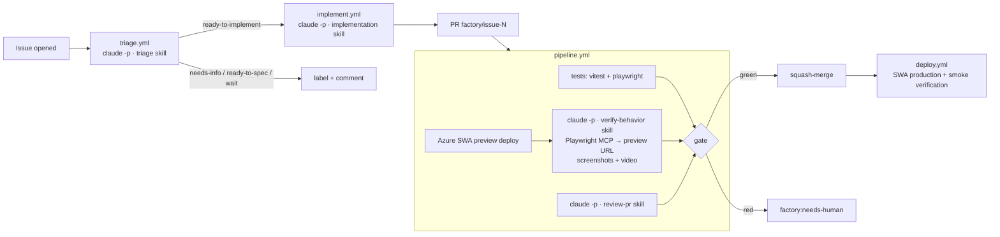

# Claude Todo Factory

A cloud software factory built on **Claude Code headless (`claude -p`)** running on GitHub Actions.
It is a port of [`warpdotdev-demos/cloud-factory-demo`](https://github.com/warpdotdev-demos/cloud-factory-demo), which used Oz/Warp agents.
The factory's target product is a tiny vanilla JS todo app deployed to **Azure Static Web Apps**.



## Stages

| Stage | Workflow | Skill | Model (default) | Agent can… |
|---|---|---|---|---|
| Triage | `triage.yml` | `triage` | claude-sonnet-5-5 | read the repo |
| Implement | `implement.yml` | `implementation` | claude-sonnet-5-5 | edit files, run `npm test` / Playwright |
| Review | `pipeline.yml` | `review-pr` | claude-sonnet-5-5 | read the repo |
| Verify (engine) | `pipeline.yml`, `deploy.yml` | `verify-behavior` | claude-sonnet-5-5 | drive a headless browser (Playwright MCP) |

**Agents propose, workflows act.** No agent ever holds a GitHub write token.
Each stage returns JSON enforced by `--json-schema` (`factory/schemas/`). Deterministic
workflow steps then apply labels, open PRs, post reviews, merge, and deploy.
Stages chain through `workflow_dispatch`, because events created with `GITHUB_TOKEN` don't trigger workflows.

### Auto-merge gate
A PR merges only when all of these hold:
1. Unit and e2e tests pass (re-run by the workflow, not taken from the agent's word).
2. The review verdict is `approve` with no `blocking` findings.
3. The verification engine reports `pass` on the Azure preview URL.
4. Every passing criterion has a screenshot that actually exists.

### Verification engine
`factory/mcp/playwright.json` runs `@playwright/mcp` in headless Chrome with video recording.
Claude reads the acceptance criteria that triage wrote (stored in a hidden marker in the triage comment),
exercises each one on the deployed URL, and saves `.factory/evidence/<ID>-*.png`.
The workflow pushes the evidence to the `factory-evidence` branch and posts a report on the PR with inline screenshots and the video.

## Setup

Secrets: `ANTHROPIC_API_KEY`, `ANTHROPIC_WORKSPACE_ID`, and `AZURE_STATIC_WEB_APPS_API_TOKEN`.
The API key is not workspace-scoped, so `factory/scripts/claude-run.sh` sends
`ANTHROPIC_CUSTOM_HEADERS="anthropic-workspace-id: …"`.
Optional repo variables: `TRIAGE_MODEL`, `IMPLEMENT_MODEL`, `REVIEW_MODEL`, `VERIFY_MODEL`.

Repo settings: Actions → *Read and write permissions* + *Allow GitHub Actions to create and approve pull requests*.

## Local dev

```bash
npm ci && npx playwright install chromium
npm start          # http://127.0.0.1:4173
npm run check      # unit + e2e
```

## Spec-kit
The factory was planned with [spec-kit](https://github.com/github/spec-kit): see
`.specify/memory/constitution.md` and `specs/001-claude-software-factory/`.
