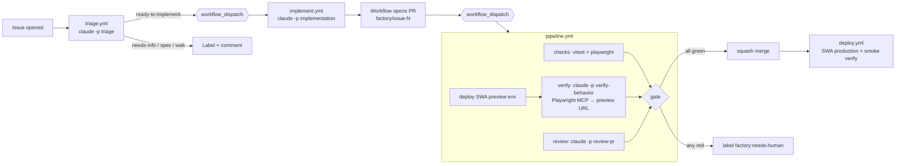

# Implementation Plan: Claude Software Factory for a Todo App

**Branch**: `001-claude-software-factory` | **Date**: 2026-11-11 | **Spec**: [spec.md](./spec.md)

## Summary

Port the reference `cloud-factory-demo` (Oz agents on Warp) to Claude Code
headless (`claude -p`) running on GitHub Actions runners. Each factory stage is a
Claude Code skill in `.claude/skills/` + a workflow in `.github/workflows/`.
The target product is a no-build vanilla JS todo app deployed to Azure Static
Web Apps (SWA). The verification engine is a Claude headless run driving
Playwright MCP against the SWA preview URL, recording video and screenshots.

## Mapping: reference (Oz) → this repo (Claude headless)

| Reference | This repo |
|---|---|
| `warpdotdev/oz-agent-action` (`cloud: true`) | `factory/scripts/claude-run.sh` → `claude -p --output-format json --json-schema …` on the Actions runner |
| `WARP_API_KEY` | `ANTHROPIC_API_KEY` + `ANTHROPIC_WORKSPACE_ID` (sent as `ANTHROPIC_CUSTOM_HEADERS`) |
| `.agents/skills/*` | `.claude/skills/{triage,implementation,review-pr,verify-behavior}` |
| Oz computer-use subagent | Claude + `@playwright/mcp` (headless Chromium, `recordVideo`) |
| Agent writes `review.json` | `--json-schema` → `structured_output`, validated by schema |
| Human merge | Auto-merge gate (tests + review + verify) |
| (no deploy) | Azure SWA preview env per PR + production on `main` |

## Technical Context

**Language/Version**: JavaScript (ES modules), Node 22 on runners
**Primary Dependencies**: none at runtime; dev: `vitest`, `@playwright/test`, `@playwright/mcp`, `@anthropic-ai/claude-code`
**Storage**: browser `localStorage`
**Testing**: Vitest (logic), Playwright (e2e, local static server)
**Target Platform**: Azure Static Web Apps (Free), GitHub Actions `ubuntu-latest`
**Models**: `claude-sonnet-5-5` for every stage (never Opus); overridable via repo variables
**Constraints**: per-run `--max-budget-usd`; agents read-only to GitHub

## Constitution Check

- I. Agents propose, workflows act — ✅ agents get no `GH_TOKEN` with write scope; git/gh writes live in workflow steps.
- II. Structured handoffs — ✅ `factory/schemas/*.json` via `--json-schema`.
- III. Evidence before merge — ✅ `pipeline.yml` `gate` job.
- IV. Small app — ✅ `app/` no build step.
- V. Bounded cost — ✅ budget, allowedTools, timeouts.

## Architecture



## Project Structure

```text
app/                      # deployed to SWA as-is
  index.html
  styles.css
  staticwebapp.config.json
  src/todo.js             # pure state logic
  src/storage.js          # localStorage adapter
  src/main.js             # DOM wiring
tests/unit/*.test.js      # vitest
tests/e2e/*.spec.js       # playwright
factory/
  schemas/{triage,implementation,review,verification}.json
  scripts/claude-run.sh   # headless wrapper: auth headers, budget, schema, logs
  scripts/publish-evidence.sh
  mcp/playwright.json     # MCP config for verification (video on)
.claude/skills/{triage,implementation,review-pr,verify-behavior}/SKILL.md
.github/workflows/{triage,implement,pipeline,deploy,close-preview}.yml
vision.md roadmap.md CLAUDE.md README.md
```

## Key design decisions

1. **Chaining with `workflow_dispatch`** — `GITHUB_TOKEN` events don't trigger workflows, but `workflow_dispatch` / `repository_dispatch` calls do. Triage → implement → pipeline → deploy are each dispatched explicitly.
2. **Previews deployed from our own pipeline**, not SWA's built-in PR trigger, using `Azure/static-web-apps-deploy@v1` with `deployment_environment: pr<N>`. The action outputs `static_web_app_url`.
3. **Verification engine** = Claude + Playwright MCP with `contextOptions.recordVideo`. The agent maps every acceptance criterion from the issue to a pass/fail with a screenshot. Evidence is uploaded as an artifact and screenshots are pushed to an orphan `factory-evidence` branch so the PR comment can embed them.
4. **Serialized pipeline** — `concurrency: factory-pipeline` (no cancel) so merges happen one at a time.

## Complexity Tracking

| Choice | Why | Simpler alternative rejected |
|---|---|---|
| Orphan evidence branch | Inline screenshots in PR comments | Artifacts only: reviewers must download zips |
